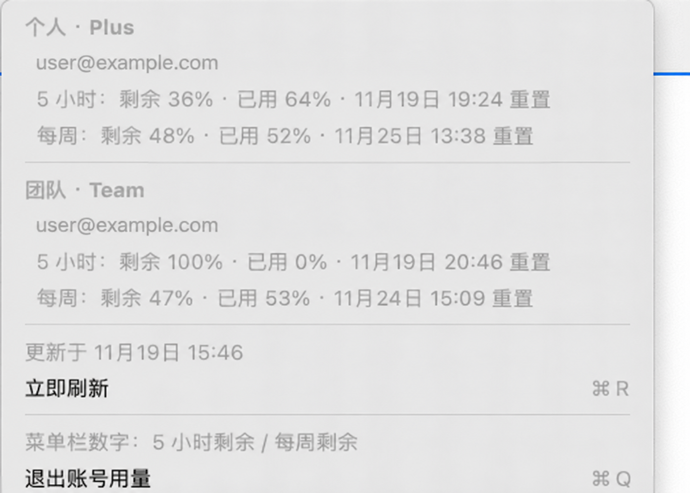

# Codex Usage Monitor


在本机查看多个 ChatGPT/Codex 账号的 5 小时与每周用量窗口。项目同时提供
Codex MCP 工具、ChatGPT MCP App，以及常驻 macOS 顶部菜单栏的双账号用量显示。

> [!IMPORTANT]
> 本项目是非官方社区工具，与 OpenAI 无隶属或背书关系。它依赖本机 Codex CLI 的 `app-server` 接口，该接口未来可能变化。

## 截图



> 脱敏示例：菜单栏数字依次表示“5 小时剩余百分比 / 每周剩余百分比”。

## 功能

- 查看 5 小时和每周窗口的已用比例、剩余比例与重置时间。
- 使用独立 `CODEX_HOME` 隔离第二账号，不覆盖当前 Codex 登录。
- 在 Codex 对话中通过 `get_usage` 工具读取第二账号用量。
- 在 ChatGPT Chat/Work 界面提供 MCP App 面板与浏览器登录流程。
- 在 macOS 菜单栏同时显示个人与团队账号，并每 5 分钟自动刷新。
- 所有认证和查询均留在本机，不经过项目自建服务器。

## 支持范围

| 入口 | 能力 | 说明 |
| --- | --- | --- |
| macOS 菜单栏 | 同时显示主账号与第二账号 | 当前固定为“个人/团队”两个槽位 |
| Codex | 调用 `get_usage` | Codex 左侧栏当前不会显示第三方全局 App 图标 |
| ChatGPT Chat/Work | 登录、刷新、断开第二账号 | 通过 MCP App 全局入口显示 |

## 工作原理

```text
macOS 菜单栏 / MCP App / Codex 工具
                 │
                 ▼
        本地 Node.js MCP Server
                 │
       ┌─────────┴─────────┐
       ▼                   ▼
主账号 codex app-server   第二账号 codex app-server
~/.codex                 独立 CODEX_HOME
```

程序通过本地 JSON-RPC 调用：

- `account/read`：读取邮箱与套餐类型。
- `account/rateLimits/read`：读取窗口时长、已用百分比和重置时间。

`300` 分钟窗口显示为“5 小时”，`10080` 分钟窗口显示为“每周”，剩余比例按 `100 - usedPercent` 计算。

## 环境要求

- macOS 13 或更高版本。
- Codex CLI 0.170.0 或更高版本。
- Node.js 22.6 或更高版本。
- 安装菜单栏应用时需要 Xcode Command Line Tools（提供 Swift 编译器）。

## 安装插件

```bash
git clone git@github.com:lingfeng1920/codex-usage.git
cd codex-usage
./scripts/install-local.sh
```

安装脚本会：

1. 安装锁定版本的 npm 依赖。
2. 运行类型检查、测试和构建。
3. 创建精简的本地插件运行包。
4. 注册本地插件市场并安装 `multi-account-usage`。

完成后完全退出并重新打开 ChatGPT/Codex 桌面端。

## 连接第二账号

1. 切换到 ChatGPT 的 Chat 或 Work 界面。
2. 从全局 App 入口打开“账号用量”。
3. 点击“连接账号”，在系统浏览器完成登录。
4. 返回面板并点击“刷新”。

连接完成后，可在 Codex 对话中输入“查看另一个账号用量”调用同一份本地数据。

第二账号默认保存在 `~/.codex-multi-account-usage/secondary-codex`。
如果桌面端提供 `PLUGIN_DATA`，则优先使用插件专属数据目录；也可通过
`MULTI_ACCOUNT_CODEX_HOME` 显式指定。

## 安装 macOS 菜单栏应用

先完成第二账号登录，然后运行：

```bash
./scripts/install-menu-bar.sh
```

应用会安装到：

```text
~/Applications/Codex Usage Monitor.app
```

菜单栏标题示例：

```text
个36/48 · 团100/47
```

`个` 表示个人账号，`团` 表示团队账号；每组数字依次是“5 小时剩余 / 每周剩余”。点击标题可查看邮箱、套餐、已用/剩余比例和重置时间，也可以立即刷新或退出。

## 隐私与安全

- 项目不会解析、打印或上传账号 Token。
- 认证文件由 Codex CLI 保存在各自独立的本地配置目录。
- MCP 工具结果只包含邮箱、套餐、限额百分比和重置时间。
- 菜单栏应用直接调用本机打包的快照程序，不发起模型对话。
- 仓库不应提交 `auth.json`、`.env`、私钥、证书或生成的 `config.json`。

## 当前限制

- 菜单栏应用仅支持 macOS。
- 当前 UI 固定显示两个账号；底层可以扩展，但尚未提供任意账号列表管理。
- 不会根据邮箱自动发现账号，每个账号都需要在独立 `CODEX_HOME` 中登录。
- Codex 左侧栏不支持第三方常驻动态卡片，因此实时信息显示在 macOS 菜单栏。
- Codex CLI 或 `app-server` 协议升级后可能需要同步适配。

## 开发与验证

```bash
npm ci --registry=https://registry.npmjs.org
npm run check
```

`npm run check` 会依次执行 TypeScript 类型检查、Vitest 测试和生产构建。

主要目录：

```text
src/                         MCP Server、Codex 客户端与用量归一化
public/usage-widget.html     ChatGPT MCP App 界面
macos/                       原生 AppKit 菜单栏应用
scripts/install-local.sh     本地插件安装脚本
scripts/install-menu-bar.sh  菜单栏应用构建与安装脚本
test/                        单元测试
```

## 卸载

卸载插件：

```bash
codex plugin remove multi-account-usage@multi-account-local
codex plugin marketplace remove multi-account-local
```

菜单栏应用可从菜单中选择“退出账号用量”，然后删除：

```text
~/Applications/Codex Usage Monitor.app
```

卸载不会自动删除第二账号认证数据。确认不再需要后，再手动删除对应的独立 `CODEX_HOME`。

## 贡献

欢迎提交 Issue 或 Pull Request。提交前请运行 `npm run check`，并确保示例、日志和截图中不包含真实邮箱、Token 或本机私密路径。

## License

[MIT](LICENSE) © 2026 东隅
